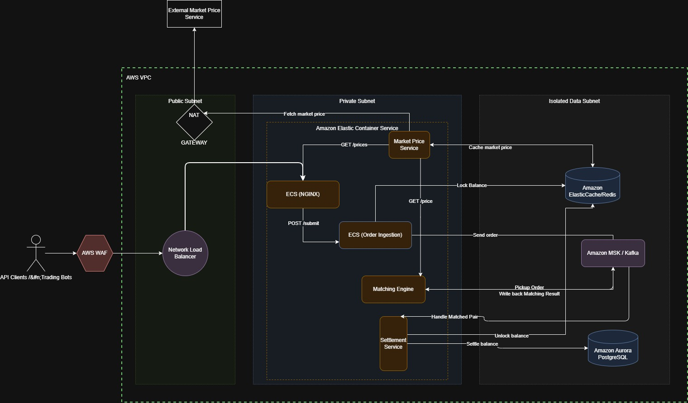

# Problem 1: Building Castle In The Cloud
HA Trading platform similar to Binance.

Throughput 500 requests per second
p99 response time of <100ms

# 1. Architecture Diagram

# 2. Solution Approach

I am using ECS because the traffic requirement is 500 requests per second with a p99 response time of <100ms, and ECS provides the necessary scalability and operational simplicity to meet these demands. EKS could also be considered but I believe it is an overkill for this specific use case, given the added operational complexity, the need for Kubernetes expertise and additional network routing that increase latency.

## 2.1 Selected Feature of the Trading Platform

### 2.1.1 NGINX
An ECS service running NGINX in the Private Subnet acts as our lightweight Layer 7 API Gateway and reverse proxy. It is chosen over heavier enterprise API gateways (like Kong) to prioritize raw performance and operational simplicity. It handles path-based routing, rate-limiting, and connection queuing to protect backend services while easily maintaining the strict <100ms SLA.

### 2.1.2 Market Price Service
An ECS service in the Private Subnet that manages the exchange's pricing data. 
- It fetches external stock and coin prices from external APIs via a NAT Gateway in the Public Subnet. 
- It caches this external data in Amazon ElastiCache (Redis) for ultra-fast, microsecond subsequent access.

### 2.1.3 Order Ingestion Service
An ECS service responsible for receiving order requests routed through NGINX. To meet latency constraints, it handles state via a highly optimized flow: before accepting an order, it validates and locks the user's available balance directly in Redis. Once locked, it appends the order payload to Amazon MSK (Kafka) to be processed asynchronously by downstream services.

### 2.1.4 Order Matching Engine
The core execution ECS service that continuously consumes open orders from the MSK topic. It maintains the order book in-memory for fast matching. Once a buy and sell order match, it immediately writes the "Matched Pair" result back to MSK as an event.

### 2.1.5 Settlement Service
An asynchronous ECS worker that consumes the matched events from MSK. It performs the final financial commit by permanently updating user balances in the Aurora PostgreSQL database and subsequently unlocking the temporarily reserved funds in Redis. 

### 2.1.6 RBAC - Authentication and Authorization
To be implemented later in problem 5.

## 2.2 AWS Features

### 2.2.1 Public Subnet (DMZ)
#### 2.2.1.1 Internet Gateway (IGW)
Provides the VPC with direct access to the internet.
#### 2.2.1.2 Network Load Balancer (NLB)
Chosen specifically over an Application Load Balancer (ALB) to satisfy the strict <100ms SLA. Operating at Layer 4 (TCP), the NLB acts as a lightning-fast pipe that forwards traffic directly to NGINX without the overhead of Layer 7 HTTP header inspection. It also natively absorbs instant, massive traffic spikes (common in financial markets) without requiring pre-warming, and reduces costs by billing for raw network bandwidth rather than complex request evaluations. Cost on more ECS NGINX instances scales linearly with traffic, avoiding the nonlinear cost growth seen with ALBs.
#### 2.2.1.3 NAT Gateway
Allows private containers (like the Market Price Service) to securely initiate outbound connections to fetch external API data without ever exposing public IP addresses to inbound internet traffic.

### 2.2.2 Private Subnet (Compute)
Providing a strong security boundary and minimizing the external attack surface.

### 2.2.3 Isolated Data Subnet (State)
A strictly internal subnet with no routing to the NAT Gateway or internet, hosting all stateful managed services.
#### 2.2.3.1 Amazon ElastiCache (Redis)
Provides sub-millisecond in-memory caching for external market prices and handles distributed locking for user balances during order ingestion.
#### 2.2.3.2 Amazon MSK (Kafka)
Acts as the event-driven backbone of the CQRS architecture. It decouples the lightning-fast Order Ingestion and Matching engines from the slower, ACID-compliant Settlement database operations.
#### 2.2.3.3 Amazon Aurora PostgreSQL
Chosen over standard Amazon RDS for the financial settlement layer. Its log-structured, decoupled distributed storage architecture allows for significantly higher write-throughput (crucial for settling thousands of trades) and provides sub-millisecond read replica lag compared to standard EBS-backed RDS instances.

# 3. Future Considerations
- Consider implementing RBAC for fine-grained access control to enhance security.
- Explore the use of AWS Lambda for certain async background tasks.
- Evaluate migrating the Settlement Service database to Aurora Serverless v2. Serverless v2 can instantly scale compute capacity up and down in fractions of a second. This provides massive cost optimization during low-traffic periods.
- As the product grows to more components, consider using Kubernetes (EKS) for more advanced orchestration and management of containerized workloads.